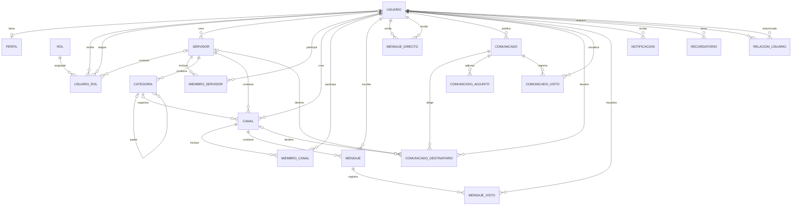

# Diagrama entidad-relación

**Última actualización:** 29/10/2026

Este documento describe las 19 entidades registradas en `backend/app/models`, de acuerdo con sus modelos SQLAlchemy actuales. Los nombres de tablas, columnas, tipos, claves foráneas, restricciones explícitas y valores predeterminados se han tomado de esos modelos.

> Los valores predeterminados de fecha se generan en la aplicación mediante `datetime.utcnow`. Las referencias a valores como `chat`, `global` o `tutor` describen convenciones del código: los modelos no declaran restricciones `CHECK` que limiten esos valores.
>
> Las tablas de campos indican si la columna es obligatoria (`nullable=False`) y documentan las restricciones y valores predeterminados declarados por el modelo. Los valores `default` de SQLAlchemy se aplican desde la aplicación; `server_default` se aplica en la base de datos.

**Índices:** los modelos no declaran índices explícitos (`index=True` o `Index`). Las claves primarias y restricciones `unique=True` sí están indicadas en sus entidades.

## Diagrama entidad-relación

Las relaciones opcionales del diagrama corresponden a claves foráneas que aceptan `NULL`. `USUARIO_ROL` y `MIEMBRO_SERVIDOR` son entidades de asociación; los destinos de `COMUNICADO_DESTINATARIO` son opcionales en el modelo. `COMUNICADO_ADJUNTO` corresponde a la entidad física `comunicado_adjunto`.

## Entidades

En las tablas siguientes, **Obligatorio** indica `nullable=False`; las claves primarias también son obligatorias. Si el modelo no especifica `nullable`, la columna permite `NULL` según la configuración predeterminada de SQLAlchemy.

### Usuario — `usuario`

Descripción: cuenta e identidad básica de una persona usuaria.
Índices explícitos: ninguno; `nombre_usuario` y `email` son únicos.

| Campo | Tipo | Obligatorio | Restricciones / valor predeterminado |
|---|---|---:|---|
| `id_usuario` | Integer | Sí | PK, autoincremental |
| `nombre_usuario` | String(100) | Sí | Único |
| `email` | String(100) | Sí | Único |
| `contrasena_hash` | String(255) | Sí | — |
| `fecha_registro` | DateTime | No | `datetime.utcnow` |
| `activo` | Boolean | No | `True` |

### Perfil — `perfil`

Descripción: información personal opcional asociada a una cuenta.
Índices explícitos: ninguno; `usuario_id` y `dni` son únicos.

| Campo | Tipo | Obligatorio | Restricciones / valor predeterminado |
|---|---|---:|---|
| `id_perfil` | Integer | Sí | PK, autoincremental |
| `usuario_id` | Integer | Sí | FK → `usuario.id_usuario`, único |
| `nombres` | String(100) | No | — |
| `apellidos` | String(100) | No | — |
| `foto_perfil` | String(255) | No | — |
| `biografia` | Text | No | — |
| `dni` | String(8) | No | Único |

`usuario_id` único hace que cada perfil pertenezca a un solo usuario y que un usuario tenga como máximo un perfil.

### Rol — `rol`

Descripción: catálogo de roles globales o de servidor.
Índices explícitos: ninguno; `nombre` es único.

| Campo | Tipo | Obligatorio | Restricciones / valor predeterminado |
|---|---|---:|---|
| `id_rol` | Integer | Sí | PK, autoincremental |
| `nombre` | String(50) | Sí | Único |
| `descripcion` | Text | No | — |
| `tipo` | String(20) | Sí | Se documentan `global` y `servidor`; sin restricción de valores en el modelo |

### UsuarioRol — `usuario_rol`

Descripción: asignación de un rol a un usuario, opcionalmente dentro de un servidor y con un asignador.
Índices explícitos: ninguno.

| Campo | Tipo | Obligatorio | Restricciones / valor predeterminado |
|---|---|---:|---|
| `id_usuario_rol` | Integer | Sí | PK, autoincremental |
| `usuario_id` | Integer | Sí | FK → `usuario.id_usuario` |
| `rol_id` | Integer | Sí | FK → `rol.id_rol` |
| `servidor_id` | Integer | No | FK → `servidor.id_servidor` |
| `fecha_asignacion` | DateTime | No | `datetime.utcnow` |
| `asignado_por` | Integer | No | FK → `usuario.id_usuario` |

### Servidor — `servidor`

Descripción: espacio que contiene categorías, canales y miembros.
Índices explícitos: ninguno.

| Campo | Tipo | Obligatorio | Restricciones / valor predeterminado |
|---|---|---:|---|
| `id_servidor` | Integer | Sí | PK, autoincremental |
| `nombre` | String(100) | Sí | — |
| `descripcion` | Text | No | — |
| `fecha_creacion` | DateTime | No | `datetime.utcnow` |
| `creador_id` | Integer | Sí | FK → `usuario.id_usuario` |

### MiembroServidor — `miembro_servidor`

Descripción: asociación de pertenencia entre un usuario y un servidor; su clave primaria es compuesta.
Índices explícitos: ninguno adicional a la clave primaria.

| Campo | Tipo | Obligatorio | Restricciones / valor predeterminado |
|---|---|---:|---|
| `usuario_id` | Integer | Sí | PK compuesta, FK → `usuario.id_usuario` |
| `servidor_id` | Integer | Sí | PK compuesta, FK → `servidor.id_servidor` |
| `fecha_union` | DateTime | No | `datetime.utcnow` |
| `activo` | Boolean | No | `True` |

### Categoria — `categoria`

Descripción: categoría jerárquica perteneciente a un servidor.
Índices explícitos: ninguno.

| Campo | Tipo | Obligatorio | Restricciones / valor predeterminado |
|---|---|---:|---|
| `id_categoria` | Integer | Sí | PK, autoincremental |
| `nombre` | String(100) | Sí | — |
| `descripcion` | Text | No | — |
| `padre_id` | Integer | No | FK → `categoria.id_categoria` |
| `servidor_id` | Integer | Sí | FK → `servidor.id_servidor` |
| `orden` | Integer | No | `0` |

### Canal — `canal`

Descripción: canal de un servidor, con creador y categoría opcional.
Índices explícitos: ninguno.

| Campo | Tipo | Obligatorio | Restricciones / valor predeterminado |
|---|---|---:|---|
| `id_canal` | Integer | Sí | PK, autoincremental |
| `nombre` | String(100) | Sí | — |
| `descripcion` | Text | No | — |
| `servidor_id` | Integer | Sí | FK → `servidor.id_servidor` |
| `creador_id` | Integer | Sí | FK → `usuario.id_usuario` |
| `categoria_id` | Integer | No | FK → `categoria.id_categoria` |
| `orden` | Integer | No | `0` |
| `tipo` | String(20) | Sí | `chat`; también se documenta `informativo`, sin restricción de valores en el modelo |

### MiembroCanal — `miembro_canal`

Descripción: asociación de un usuario a un canal, con un rol dentro de ese canal.
Índices explícitos: ninguno.

| Campo | Tipo | Obligatorio | Restricciones / valor predeterminado |
|---|---|---:|---|
| `id_miembro_canal` | Integer | Sí | PK, autoincremental |
| `usuario_id` | Integer | Sí | FK → `usuario.id_usuario` |
| `canal_id` | Integer | Sí | FK → `canal.id_canal` |
| `fecha_union` | DateTime | No | `datetime.utcnow` |
| `rol_en_canal` | String(20) | Sí | `miembro`; también se documentan `admin` y `tutor`, sin restricción de valores en el modelo |

El modelo no declara una restricción única sobre el par `usuario_id` y `canal_id`.

### Mensaje — `mensaje`

Descripción: mensaje publicado por un usuario en un canal.
Índices explícitos: ninguno.

| Campo | Tipo | Obligatorio | Restricciones / valor predeterminado |
|---|---|---:|---|
| `id_mensaje` | Integer | Sí | PK, autoincremental |
| `contenido` | Text | Sí | — |
| `fecha_envio` | DateTime | No | `datetime.utcnow` |
| `editado` | Boolean | No | `False` |
| `usuario_id` | Integer | Sí | FK → `usuario.id_usuario` |
| `canal_id` | Integer | Sí | FK → `canal.id_canal` |

### MensajeDirecto — `mensaje_directo`

Descripción: mensaje privado enviado de un usuario a otro.
Índices explícitos: ninguno.

| Campo | Tipo | Obligatorio | Restricciones / valor predeterminado |
|---|---|---:|---|
| `id_mensaje_directo` | Integer | Sí | PK, autoincremental |
| `contenido` | Text | Sí | — |
| `fecha_envio` | DateTime | No | `datetime.utcnow` |
| `leido` | Boolean | No | `False` |
| `fecha_leido` | DateTime | No | — |
| `emisor_id` | Integer | Sí | FK → `usuario.id_usuario` |
| `receptor_id` | Integer | Sí | FK → `usuario.id_usuario` |

### Comunicado — `comunicado`

Descripción: comunicado publicado por un usuario, con borrado lógico y fecha de evento opcional.
Índices explícitos: ninguno.

| Campo | Tipo | Obligatorio | Restricciones / valor predeterminado |
|---|---|---:|---|
| `id_comunicado` | Integer | Sí | PK, autoincremental |
| `titulo` | String(200) | Sí | — |
| `contenido` | Text | Sí | — |
| `fecha_publicacion` | DateTime | No | `datetime.utcnow` |
| `fecha_evento` | DateTime | No | — |
| `publicado_por` | Integer | Sí | FK → `usuario.id_usuario` |
| `tipo` | String(20) | Sí | `global`; también se documentan `servidor`, `canal` y `usuario`, sin restricción de valores en el modelo |
| `eliminado` | Boolean | Sí | `False`, `server_default="false"` |

### ComunicadoDestinatario — `comunicado_destinatario`

Descripción: destinos opcionales asociados a un comunicado.
Índices explícitos: ninguno.

| Campo | Tipo | Obligatorio | Restricciones / valor predeterminado |
|---|---|---:|---|
| `id_comunicado_destinatario` | Integer | Sí | PK, autoincremental |
| `comunicado_id` | Integer | Sí | FK → `comunicado.id_comunicado`, `ON DELETE CASCADE` |
| `servidor_id` | Integer | No | FK → `servidor.id_servidor` |
| `canal_id` | Integer | No | FK → `canal.id_canal` |
| `usuario_id` | Integer | No | FK → `usuario.id_usuario` |

Los modelos permiten que las tres columnas de destinatario sean nulas; no declaran una regla que obligue a elegir exactamente un destino.

### ComunicadoAdjunto — `comunicado_adjunto`

Descripción: archivo almacenado en Cloudinary y asociado a un comunicado.
Índices explícitos: ninguno.

| Campo | Tipo | Obligatorio | Restricciones / valor predeterminado |
|---|---|---:|---|
| `id` | Integer | Sí | PK, autoincremental |
| `comunicado_id` | Integer | Sí | FK → `comunicado.id_comunicado`, `ON DELETE CASCADE` |
| `nombre_original` | String(255) | Sí | — |
| `url` | String(500) | Sí | — |
| `public_id` | String(255) | Sí | — |
| `tipo_mime` | String(150) | Sí | — |
| `tamano_bytes` | Integer | Sí | — |
| `fecha_subida` | DateTime | Sí | `datetime.utcnow` |

### ComunicadoVisto — `comunicado_visto`

Descripción: registro de visualización de un comunicado por un usuario.
Índices explícitos: ninguno.

| Campo | Tipo | Obligatorio | Restricciones / valor predeterminado |
|---|---|---:|---|
| `id_comunicado_visto` | Integer | Sí | PK, autoincremental |
| `comunicado_id` | Integer | Sí | FK → `comunicado.id_comunicado`, `ON DELETE CASCADE` |
| `usuario_id` | Integer | Sí | FK → `usuario.id_usuario` |
| `fecha_visto` | DateTime | No | `datetime.utcnow` |

### MensajeVisto — `mensaje_visto`

Descripción: registro de visualización de un mensaje por un usuario.
Índices explícitos: ninguno.

| Campo | Tipo | Obligatorio | Restricciones / valor predeterminado |
|---|---|---:|---|
| `id_mensaje_visto` | Integer | Sí | PK, autoincremental |
| `mensaje_id` | Integer | Sí | FK → `mensaje.id_mensaje` |
| `usuario_id` | Integer | Sí | FK → `usuario.id_usuario` |
| `fecha_visto` | DateTime | No | `datetime.utcnow` |

### Notificacion — `notificacion`

Descripción: notificación asociada a un usuario.
Índices explícitos: ninguno.

| Campo | Tipo | Obligatorio | Restricciones / valor predeterminado |
|---|---|---:|---|
| `id_notificacion` | Integer | Sí | PK, autoincremental |
| `usuario_id` | Integer | Sí | FK → `usuario.id_usuario` |
| `mensaje` | Text | Sí | — |
| `leida` | Boolean | No | `False` |
| `fecha_creacion` | DateTime | No | `datetime.utcnow` |
| `tipo` | String(50) | Sí | — |
| `enlace` | String(255) | No | — |

### Recordatorio — `recordatorio`

Descripción: recordatorio asociado a un usuario, con fecha límite opcional.
Índices explícitos: ninguno.

| Campo | Tipo | Obligatorio | Restricciones / valor predeterminado |
|---|---|---:|---|
| `id_recordatorio` | Integer | Sí | PK, autoincremental |
| `titulo` | String(200) | Sí | — |
| `descripcion` | Text | No | — |
| `fecha_creacion` | DateTime | No | `datetime.utcnow` |
| `fecha_limite` | DateTime | No | — |
| `completado` | Boolean | No | `False` |
| `usuario_id` | Integer | Sí | FK → `usuario.id_usuario` |

### RelacionUsuario — `relacion_usuario`

Descripción: relación tipada entre dos usuarios.
Índices explícitos: ninguno.

| Campo | Tipo | Obligatorio | Restricciones / valor predeterminado |
|---|---|---:|---|
| `id_relacion` | Integer | Sí | PK, autoincremental |
| `usuario_id` | Integer | Sí | FK → `usuario.id_usuario` |
| `relacionado_id` | Integer | Sí | FK → `usuario.id_usuario` |
| `tipo` | String(50) | Sí | Se documentan `padre`, `madre`, `tutor`, `hermano`, entre otros; sin restricción de valores en el modelo |
| `fecha_creacion` | DateTime | No | `datetime.utcnow` |

## Relaciones y claves foráneas

| Entidad | Campo | Referencia |
|---|---|---|
| `perfil` | `usuario_id` | `usuario.id_usuario` |
| `usuario_rol` | `usuario_id` | `usuario.id_usuario` |
| `usuario_rol` | `rol_id` | `rol.id_rol` |
| `usuario_rol` | `servidor_id` | `servidor.id_servidor` |
| `usuario_rol` | `asignado_por` | `usuario.id_usuario` |
| `servidor` | `creador_id` | `usuario.id_usuario` |
| `miembro_servidor` | `usuario_id` | `usuario.id_usuario` |
| `miembro_servidor` | `servidor_id` | `servidor.id_servidor` |
| `categoria` | `padre_id` | `categoria.id_categoria` |
| `categoria` | `servidor_id` | `servidor.id_servidor` |
| `canal` | `servidor_id` | `servidor.id_servidor` |
| `canal` | `creador_id` | `usuario.id_usuario` |
| `canal` | `categoria_id` | `categoria.id_categoria` |
| `miembro_canal` | `usuario_id` | `usuario.id_usuario` |
| `miembro_canal` | `canal_id` | `canal.id_canal` |
| `mensaje` | `usuario_id` | `usuario.id_usuario` |
| `mensaje` | `canal_id` | `canal.id_canal` |
| `mensaje_directo` | `emisor_id` | `usuario.id_usuario` |
| `mensaje_directo` | `receptor_id` | `usuario.id_usuario` |
| `comunicado` | `publicado_por` | `usuario.id_usuario` |
| `comunicado_destinatario` | `comunicado_id` | `comunicado.id_comunicado` |
| `comunicado_destinatario` | `servidor_id` | `servidor.id_servidor` |
| `comunicado_destinatario` | `canal_id` | `canal.id_canal` |
| `comunicado_destinatario` | `usuario_id` | `usuario.id_usuario` |
| `comunicado_adjunto` | `comunicado_id` | `comunicado.id_comunicado` |
| `comunicado_visto` | `comunicado_id` | `comunicado.id_comunicado` |
| `comunicado_visto` | `usuario_id` | `usuario.id_usuario` |
| `mensaje_visto` | `mensaje_id` | `mensaje.id_mensaje` |
| `mensaje_visto` | `usuario_id` | `usuario.id_usuario` |
| `notificacion` | `usuario_id` | `usuario.id_usuario` |
| `recordatorio` | `usuario_id` | `usuario.id_usuario` |
| `relacion_usuario` | `usuario_id` | `usuario.id_usuario` |
| `relacion_usuario` | `relacionado_id` | `usuario.id_usuario` |

## Cardinalidades principales

- Un `usuario` puede tener cero o un `perfil`; cada `perfil` pertenece a un usuario.
- `usuario` y `rol` se relacionan mediante `usuario_rol`; la asignación puede asociarse opcionalmente a un `servidor`.
- `usuario` y `servidor` se relacionan mediante `miembro_servidor`, cuya PK está compuesta por ambas FK.
- Un `servidor` contiene categorías, canales y miembros.
- Una `categoria` puede tener una categoría padre y subcategorías; un canal puede asociarse opcionalmente a una categoría.
- `usuario` y `canal` se relacionan mediante `miembro_canal`.
- Un `canal` contiene mensajes; cada mensaje tiene un usuario autor y pertenece a un canal.
- Cada mensaje directo tiene un usuario emisor y un usuario receptor.
- Un comunicado tiene un usuario autor y puede tener destinatarios y registros de visualización.
- `mensaje_visto` registra un mensaje y un usuario; `comunicado_visto` registra un comunicado y un usuario.
- Un usuario puede tener notificaciones, recordatorios y relaciones con otros usuarios.

## Enums y tipos personalizados

Los modelos SQLAlchemy no declaran tipos `Enum` ni tipos SQL personalizados. Los campos `tipo` y `rol_en_canal` son columnas `String`; algunos schemas Pydantic limitan sus valores de entrada mediante `Literal`, lo cual no convierte las columnas del modelo en enums de base de datos.

## Resumen

| # | Entidad | Propósito |
|---:|---|---|
| 1 | `usuario` | Cuenta e identidad de usuario |
| 2 | `perfil` | Información complementaria del usuario |
| 3 | `rol` | Catálogo de roles |
| 4 | `usuario_rol` | Asignación de roles a usuarios, opcionalmente en un servidor |
| 5 | `servidor` | Espacio con canales, categorías y miembros |
| 6 | `miembro_servidor` | Asociación de usuarios y servidores |
| 7 | `categoria` | Categorías jerárquicas de un servidor |
| 8 | `canal` | Canal perteneciente a un servidor |
| 9 | `miembro_canal` | Asociación de usuarios y canales |
| 10 | `mensaje` | Mensaje publicado en un canal |
| 11 | `mensaje_directo` | Mensaje privado entre usuarios |
| 12 | `comunicado` | Comunicado publicado por un usuario |
| 13 | `comunicado_destinatario` | Destinos opcionales de un comunicado |
| 14 | `comunicado_adjunto` | Archivo asociado a un comunicado |
| 15 | `comunicado_visto` | Registro de visualización de comunicados |
| 16 | `mensaje_visto` | Registro de visualización de mensajes |
| 17 | `notificacion` | Notificación asociada a un usuario |
| 18 | `recordatorio` | Recordatorio asociado a un usuario |
| 19 | `relacion_usuario` | Relación tipada entre dos usuarios |

**Total: 19 entidades.**

## Notas de actualización

- Se añadió la fecha de actualización y una descripción para cada entidad.
- Se explicitó que los modelos no declaran índices adicionales ni tipos `Enum` de base de datos; las restricciones únicas existentes siguen documentadas en los campos.
- Se verificó el inventario contra `backend/app/models`: actualmente existen 19 entidades; se incorporó `comunicado_adjunto` junto con su relación de cascada desde comunicado.
- Las relaciones de borrado `ON DELETE CASCADE` en `comunicado_destinatario.comunicado_id`, `comunicado_adjunto.comunicado_id` y `comunicado_visto.comunicado_id` se mantienen reflejadas en las tablas de campos.
